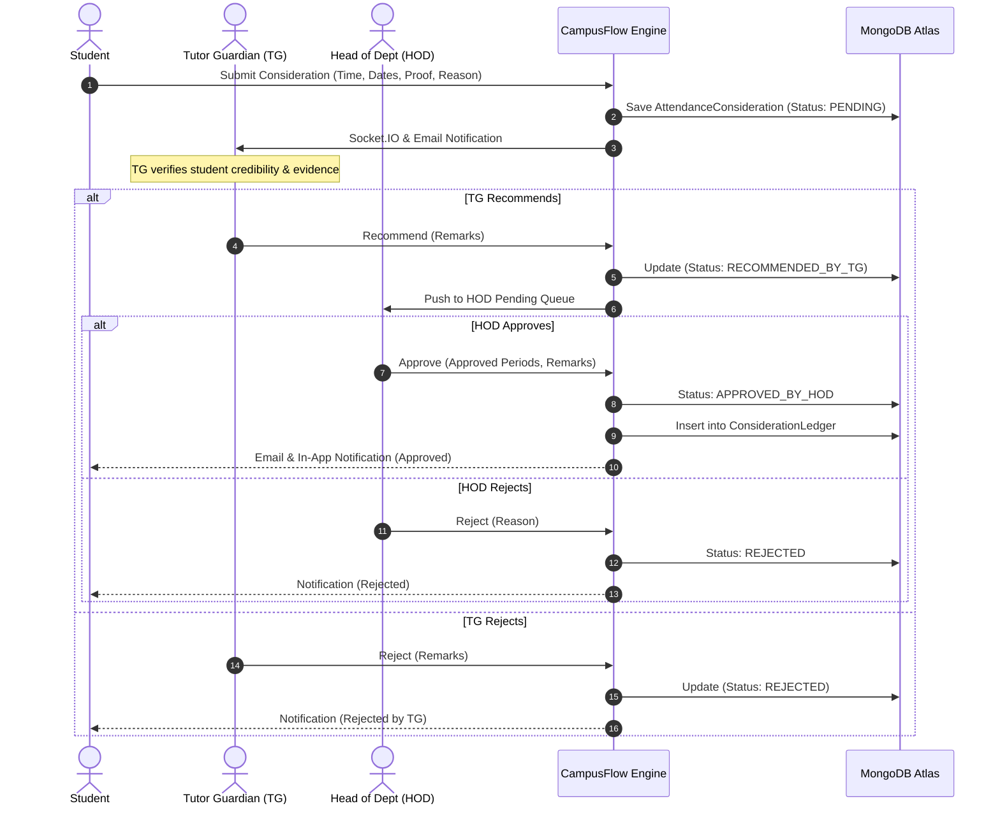
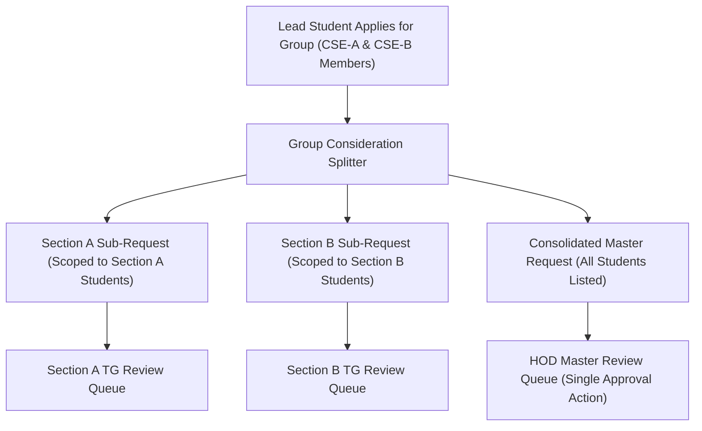
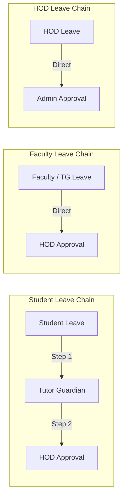
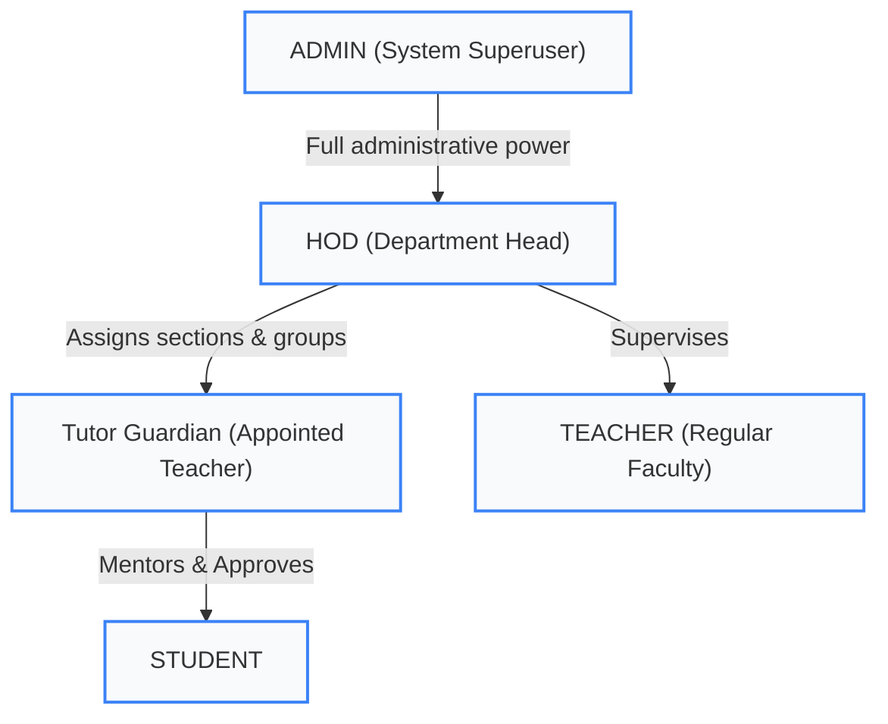

# 🎓 CampusFlow Lite — Academic Attendance Consideration & Mentorship ERP

[](https://nodejs.org/)
[](https://expressjs.com/)
[](https://react.dev/)
[](https://vitejs.dev/)
[](https://www.mongodb.com/)
[](https://socket.io/)
[](https://github.com/avinash2005bharti/campusflowlite)
[](LICENSE)

> **CampusFlow Lite** is a production-grade, full-stack Academic Operations ERP designed specifically for college departments (such as Computer Science & Engineering). It digitizes the complete lifecycle of **attendance consideration applications**, **leave workflows**, **faculty mentorship (Tutor Guardians)**, **academic section management**, and **automated ledger reporting**.

---

## 📌 Table of Contents

- [Key Highlights & Capabilities](#-key-highlights--capabilities)
- [System Architecture & Workflow Visualizations](#-system-architecture--workflow-visualizations)
  - [Consideration Request Workflow](#1-consideration-approval-chain)
  - [Group Consideration Architecture](#2-group-consideration-engine)
  - [Leave Application Hierarchy](#3-leave-approval-hierarchy)
  - [Role Hierarchy & Dynamic TG Derivation](#4-role-hierarchy--dynamic-tg-derivation)
- [Technology Stack](#-technology-stack)
- [Database Schema (12 Mongoose Models)](#-database-schema)
- [Project Directory Structure](#-project-directory-structure)
- [Getting Started & Installation](#-getting-started--installation)
  - [Prerequisites](#prerequisites)
  - [1. Clone Repository](#1-clone-repository)
  - [2. Backend Setup](#2-backend-setup)
  - [3. Frontend Setup](#3-frontend-setup)
  - [4. Database Seeding](#4-database-seeding)
- [Role-Based Access & Demo Accounts](#-role-based-access--demo-accounts)
- [API Reference Overview](#-api-reference-overview)
- [Automated Testing & Verification](#-automated-testing--verification)
- [License & Authors](#-license--authors)

---

## 🚀 Key Highlights & Capabilities

### 1. 📋 Dual Consideration Workflows (Individual & Multi-Section Group)
- **Single Consideration**: Students submit attendance consideration for events, hackathons, sports, medical emergencies, or academic seminars with start/end dates, exact time slots (`timeFrom`, `timeTo`), and proof attachments (PDF, JPG, PNG).
- **Group Considerations**:
  - A lead student can apply on behalf of multiple peers across various semesters and sections (Section A, B, C, D).
  - **Smart TG Routing Engine**: Partitioned automatically so that each section's Tutor Guardian receives a scoped request containing only their section's students.
  - **Unified Master HOD Request**: Head of Department receives a single consolidated application listing all participating students with their roll numbers, sections, and semesters to eliminate duplicate approvals.
- **Automated Ledger Generation**: Once HOD approves, verified entries are automatically written to the department's `ConsiderationLedger` for attendance compilation and audit inspection.

### 2. 🏖️ Comprehensive Multi-Tier Leave System
- **Student Leave**: Initiated by student $\rightarrow$ recommended/rejected by assigned TG $\rightarrow$ final approval/rejection by HOD.
- **Faculty Leave**: Regular teachers and TGs apply directly to HOD.
- **HOD Leave**: Applied directly to College Admin for final authorization.
- Date collision avoidance, inclusive calendar day calculations, and mandatory justification checks.

### 3. 👥 Department & Academic Master Data Control (HOD / Admin)
- **Section Overview & Zero Overlap**: Strict regex isolation (`/CSE[\s\-_]*([A-D])/i`) guaranteeing that CSE-A, CSE-B, CSE-C, and CSE-D student lists and counts remain completely independent without overlap.
- **Student Roster Management**:
  - HOD can edit student profile details, phone numbers, and enrollments.
  - **Dynamic Semester & Section Transfer**: Changing a student's semester (1–8) or section (A–D) automatically relocates the student and reassigns them to the active `MentorGroup` of their new section's Tutor Guardian.
- **Automated Temporary Password Reset**: When an Admin or HOD resets a student's credentials, the backend generates an alphanumeric temporary password (`Reset@XXXX`), hashes it, updates `mustChangePassword = true`, dispatches it to the student via transactional email, and logs an in-app notification.
- **Department Notices Broadcast**: HODs can broadcast circulars and notices targeted to all students or specific sections with priority tags (`URGENT`, `HIGH`, `NORMAL`).

### 4. 🔐 Student Self-Service Account Management
- **Email Modification**: Students can update their registered email address from the Student Dashboard or Student Profile, protected by instant current-password authorization check.
- **Password Modification**: Real-time password updates with character minimums, match validation, and eye-toggle visibility.

### 5. ⚡ Real-Time Notifications & Reports
- **Real-Time Push**: Powered by Socket.IO for immediate badge counters and modal refreshes on approval/rejection actions.
- **Email Delivery**: Integrates Brevo Transactional Email API with automated fallback to Nodemailer SMTP.
- **Audit Reports**: One-click Excel `.xlsx` report generator using `ExcelJS` containing period breakdowns, event classifications, and full approval audit logs.

---

## 📐 System Architecture & Workflow Visualizations

### 1. Consideration Approval Chain



### 2. Group Consideration Engine



### 3. Leave Approval Hierarchy



### 4. Role Hierarchy & Dynamic TG Derivation



> **Dynamic TG Derivation**: `TG` is not a static role. When a Teacher is assigned as the mentor of an active `MentorGroup` for a Section, the authentication middleware (`auth.middleware.js`) dynamically detects the relation and grants `isTG = true` permissions for that section's students.

---

## 🛠️ Technology Stack

| Layer | Technology | Version | Purpose |
|---|---|---|---|
| **Frontend Core** | React 18 | `^18.3.1` | Modern declarative component architecture |
| **Build Tool** | Vite | `^5.4.2` | Lightning-fast HMR and optimized production bundles |
| **Routing** | React Router DOM | `^6.26.2` | Client-side routing with role-based route guards |
| **Icons & UI** | Lucide React | `^1.16.0` | Clean, modern feather icon set |
| **Styling** | Vanilla CSS Design System | Custom | Curated design tokens, glassmorphism, responsive cards |
| **HTTP Client** | Axios | `^1.7.9` | Request/response interceptors with JWT auto-injection |
| **Real-Time Client** | Socket.IO Client | `^4.8.1` | WebSocket bidirectional real-time alerts |
| **Backend Runtime** | Node.js (ESM) | `>= 18.0.0` | Native ECMAScript Modules runtime |
| **Web Framework** | Express 5 | `^5.3.0` | REST API routing and middleware pipelines |
| **Database** | MongoDB Atlas | Cloud | Scalable document storage |
| **ODM** | Mongoose | `^9.11.1` | Schema validation, relationships, and lifecycle hooks |
| **Validation** | Zod | `^4.6.6` | Type-safe schema validation on incoming payloads |
| **Authentication** | JWT & bcryptjs | `^9.0.3` / `^3.0.3` | Dual token flow (access + refresh) with 12 bcrypt rounds |
| **Cloud Storage** | ImageKit SDK | `^6.0.0` | Cloud CDN storage for proof documents and PDFs |
| **Email Service** | Brevo SDK & Nodemailer | `^6.0.3` / `^10.1.0` | Transactional email delivery with SMTP fallback |
| **Report Engine** | ExcelJS | `^4.4.0` | Programmatic `.xlsx` generation for ledgers and audits |
| **Task Scheduling** | node-cron | `^4.6.0` | Scheduled jobs and periodic cleanup |

---

## 🗄️ Database Schema

The system is built upon **12 interconnected Mongoose models**:

| Model | Schema File | Description |
|---|---|---|
| `User` | `models/User.js` | Core authentication profile, roles (`ADMIN`, `HOD`, `TEACHER`, `STUDENT`), credentials, active status |
| `Student` | `models/Student.js` | Enrollment number, roll number, semester, section ref, guardian details, department |
| `Teacher` | `models/Teacher.js` | Employee ID, designation, department ref, phone, cabin location |
| `Department` | `models/Department.js` | Academic department details (e.g., Computer Science & Engineering), code, HOD ref |
| `Section` | `models/Section.js` | Class section (CSE-A, CSE-B, CSE-C, CSE-D), academic year, semester |
| `MentorGroup` | `models/MentorGroup.js` | Maps a Tutor Guardian (`Teacher`) to a specific `Section` and student pool |
| `AttendanceConsideration`| `models/AttendanceConsideration.js`| Consideration requests: event dates, time window, status, proofs, TG and HOD remarks |
| `LeaveRequest` | `models/LeaveRequest.js` | Leave applications: student/teacher leaves, date ranges, approval chain logs |
| `ConsiderationLedger`| `models/ConsiderationLedger.js` | Official departmental ledger storing approved consideration records for exams & audit |
| `Notification` | `models/Notification.js` | In-app user notifications with read/unread tracking and actionable links |
| `Notice` | `models/Notice.js` | Departmental circulars, announcements, priority tags, and broadcast audiences |
| `AuditLog` | `models/AuditLog.js` | Immutable administrative audit log tracking user changes, role reassignments, and resets |

---

## 📂 Project Directory Structure

```text
campusflowlite/
├── backend/
│   ├── src/
│   │   ├── config/              # MongoDB, ImageKit, Brevo & Socket.IO initialization
│   │   ├── middleware/          # auth, authorize, validate, rateLimiter, error handler
│   │   ├── models/              # 12 Mongoose data models
│   │   ├── modules/             # Modular controllers, routes, and business services
│   │   │   ├── auth/            # Login, register, profile update, password change
│   │   │   ├── users/           # User management, role assign, temporary password reset
│   │   │   ├── students/        # Student roster, semester/section reassignment
│   │   │   ├── teachers/        # Faculty directory and assignment
│   │   │   ├── considerations/  # Single & group attendance considerations, ledger
│   │   │   ├── leaves/          # Multi-tier leave requests & approvals
│   │   │   ├── mentorship/      # TG assignments & mentor group mappings
│   │   │   ├── sections/        # Section overview and management
│   │   │   ├── notices/         # Circulars and notice broadcasting
│   │   │   ├── dashboard/       # Aggregated stats for Student, TG, HOD, and Admin
│   │   │   └── reports/         # ExcelJS ledger and audit export generators
│   │   ├── utils/               # ApiError, ApiResponse, sendEmail, date helpers
│   │   ├── seed/                # Comprehensive mock & initial seed data script
│   │   └── server.js            # Express application bootstrap & WebSocket server
│   ├── tests/                   # 30 Unit & Integration tests (Node test runner)
│   ├── .env.example             # Environment variable template
│   └── package.json
│
├── frontend/
│   ├── src/
│   │   ├── api/                 # Axios clients for auth, considerations, leaves, etc.
│   │   ├── components/
│   │   │   ├── common/          # Button, Card, Badge, Modal, PageHeader primitives
│   │   │   ├── layout/          # Sidebar, Header, NotificationDropdown, DashboardLayout
│   │   │   └── modals/          # ApplyConsiderationModal, EditStudentModal,
│   │   │                        # StudentAccountSettingsModal, SectionOverviewModal,
│   │   │                        # SendNoticeModal, ViewConsiderationModal
│   │   ├── context/             # ERPContext (global state, user, auth, toasts, socket)
│   │   ├── pages/
│   │   │   ├── auth/            # LoginPage, RegisterPage, ForgotPasswordPage
│   │   │   ├── student/         # StudentDashboard, StudentRequests, StudentProfile
│   │   │   ├── tg/              # TgDashboard, TgStudents, TgReviewQueue
│   │   │   ├── hod/             # HodDashboard, HodConsiderations, HodStudents, HodReports
│   │   │   └── admin/           # AdminDashboard, AdminUsers, AdminSettings
│   │   ├── utils/               # Formatters, section letter isolator, status helpers
│   │   ├── App.jsx              # Application router with ProtectedRoute wrappers
│   │   ├── index.css            # Custom Vanilla CSS Design System
│   │   └── main.jsx             # React DOM entry point
│   ├── vite.config.js           # Vite dev server with proxy routing
│   └── package.json
│
├── system-architecture.md       # Detailed technical architecture specification
└── README.md                    # Project documentation
```

---

## ⚡ Getting Started & Installation

### Prerequisites
- [Node.js](https://nodejs.org/) v18.0.0 or higher
- [MongoDB](https://www.mongodb.com/) (Local instance or MongoDB Atlas connection string)
- Git installed on your system

### 1. Clone Repository
```bash
git clone https://github.com/avinash2005bharti/campusflowlite.git
cd campusflowlite
```

---

### 2. Backend Setup
1. Navigate to the `backend` directory:
   ```bash
   cd backend
   ```
2. Install dependencies:
   ```bash
   npm install
   ```
3. Create your `.env` configuration file:
   ```bash
   cp .env.example .env
   ```
4. Open `.env` and fill in your connection strings and secrets:
   ```env
   PORT=5000
   NODE_ENV=development
   MONGO_URI=mongodb+srv://<username>:<password>@cluster.mongodb.net/campusflow?retryWrites=true&w=majority
   JWT_SECRET=your_jwt_access_secret_32_characters_minimum
   JWT_REFRESH_SECRET=your_jwt_refresh_secret_32_characters_minimum
   JWT_EXPIRE=7d
   BREVO_API_KEY=your_brevo_api_key
   BREVO_SENDER_EMAIL=your_verified_email@domain.com
   BREVO_SENDER_NAME="CampusFlow Notifications"
   IMAGEKIT_PUBLIC_KEY=your_imagekit_public_key
   IMAGEKIT_PRIVATE_KEY=your_imagekit_private_key
   IMAGEKIT_URL_ENDPOINT=https://ik.imagekit.io/your_id/
   CLIENT_URL=http://localhost:5173
   ```
5. Start the backend development server:
   ```bash
   npm run dev
   ```
   *The backend will boot up at `http://localhost:5000` with WebSocket listeners enabled.*

---

### 3. Frontend Setup
1. Open a new terminal window and navigate to the `frontend` directory:
   ```bash
   cd frontend
   ```
2. Install frontend dependencies:
   ```bash
   npm install
   ```
3. Start the Vite development server:
   ```bash
   npm run dev
   ```
   *The application will launch at `http://localhost:5173`.*

---

### 4. Database Seeding (Optional but Recommended)
Populate your database with complete departmental mock data (Department, Sections A–D, HOD, TGs, Students, Considerations, and Leaves):
```bash
cd backend
npm run seed
```

---

## 👥 Role-Based Access & Demo Accounts

When the seed script is executed, you can immediately test any portal role:

| Role | Email | Password | Primary Permissions |
|---|---|---|---|
| **ADMIN** | `admin@oist.ac.in` | `Admin@123` | System management, all user access, academic master data, HOD leave approval |
| **HOD** | `hod.cse@oist.ac.in` | `Hod@123` | Final consideration approval, student roster edit (semester/section), temporary password resets, notices |
| **TG (Section B)** | `tg.cse.b@oist.ac.in` | `Teacher@123` | Mentorship review, recommend/reject considerations for Section B students |
| **TG (Section C)** | `tg.cse.c@oist.ac.in` | `Teacher@123` | Mentorship review, recommend/reject considerations for Section C students |
| **TEACHER** | Existing faculty account | Existing faculty password | Read-only view of approved consideration records in the teacher's authorized cohort |
| **STUDENT** | `student@oist.ac.in` | `Student@123` | Apply single/group considerations, apply leaves, change email/password, track status |

### Teacher consideration visibility

The Teacher Dashboard exposes only **View Consideration**. Its ledger reuses the authenticated,
read-only `/reports/considerations` API and uses the teacher's assigned department as the access
boundary. Teachers see approved consideration records for students in that department, while
teachers with an active TG assignment continue to use their existing mentor-group scope in the
TG workspace. No approval, rejection, edit, delete, or create actions are exposed to teachers.

---

## 🔌 API Reference Overview

All API endpoints are prefixed with `/api/v1/`.

| Group | Method | Endpoint | Description | Auth Required |
|---|:---:|---|---|:---:|
| **Auth** | `POST` | `/auth/login` | Login with email and password | Public |
| | `POST` | `/auth/refresh` | Refresh access token using cookie | Public |
| | `PATCH` | `/auth/profile` | Self-service update email / password | Student / Faculty |
| **Users** | `GET` | `/users` | List department users with filters | HOD, Admin |
| | `POST` | `/users/reset-password` | Reset password & email temporary credentials | HOD, Admin |
| **Students** | `GET` | `/students` | Get paginated student directory | TG, HOD, Admin |
| | `PUT` | `/students/:id` | Update student, change semester/section & TG | HOD, Admin |
| **Considerations** | `GET` | `/considerations/mine`| View own applied considerations | Student |
| | `POST` | `/considerations` | Submit single or group consideration | Student |
| | `PATCH`| `/considerations/:id/tg-review` | Recommend or reject consideration | Assigned TG |
| | `PATCH`| `/considerations/:id/hod-review`| Final approve or reject consideration | HOD, Admin |
| | `GET` | `/considerations/ledger` | Fetch approved consideration ledger | TG, HOD, Admin |
| **Leaves** | `POST` | `/leaves` | Apply for leave (Student/Faculty/HOD) | All Users |
| | `PATCH`| `/leaves/:id/review` | Progress leave approval chain | TG, HOD, Admin |
| **Notices** | `GET` | `/notices` | Fetch active notices & circulars | All Users |
| | `POST` | `/notices` | Broadcast a new notice with priority | HOD, Admin |
| **Reports** | `GET` | `/reports/considerations/export` | Download `.xlsx` consideration ledger | TG, HOD, Admin |

---

## 🧪 Automated Testing & Verification

The backend includes a comprehensive suite of **30 automated unit and integration tests** testing all critical business logic, security policies, and boundary cases:

```bash
cd backend
npm test
```

### Test Suite Highlights:
- **Section Letter Isolation**: Confirms `CSE-B` and `CSE-C` never overlap.
- **Group Consideration Partitioning**: Verifies multi-section student arrays are partitioned into section-specific TG buckets while delivering a single unified master request to the HOD.
- **Temporary Password Formatting**: Validates complexity rules (`Reset@XXXX`).
- **Student Profile Self-Service**: Tests email and password change validation.
- **Role Permission Enforcement**: Verifies strict role boundaries (TGs cannot delete student records; only HOD/Admin can reassign sections).
- **Date & Range Overlaps**: Tests inclusive calendar day calculations and format verification.

### Frontend Production Build:
```bash
cd frontend
npm run build
```
*Compiles the production bundle with 0 errors.*

---

## 📄 License & Authors

Distributed under the **MIT License**. See `LICENSE` for more information.

- **Author**: Avinash Bharti ([@avinash2005bharti](https://github.com/avinash2005bharti))
- **Repository**: [https://github.com/avinash2005bharti/campusflowlite](https://github.com/avinash2005bharti/campusflowlite)

---
*Built with ❤️ for clean, transparent, and hassle-free academic workflows.*
