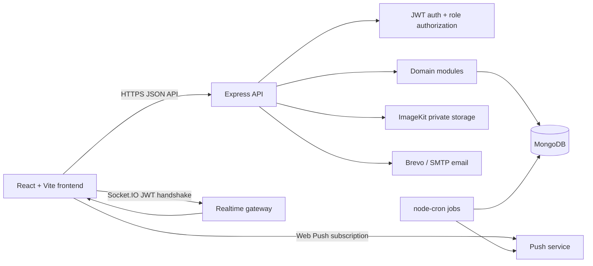

# CampusFlow Lite

CampusFlow Lite is a MERN-based academic operations system for managing student consideration requests, leave workflows, Tutor Guardian (TG) reviews, HOD approvals, faculty administration, notifications, and reporting.

The application is designed for department-level deployment and preserves a strict approval chain:

```text
Student -> Tutor Guardian (recommend/reject) -> HOD (final approve/reject)
```

## Features

- Student attendance consideration requests with individual and group applications.
- TG-scoped review queues and HOD consolidated approval queues.
- Student, faculty, TG, and HOD leave workflows.
- HOD and Admin dashboards for users, sections, faculty, mentorship, leaves, notices, reports, and audit history.
- Read-only Teacher dashboard for approved consideration records.
- Real-time in-app notifications through Socket.IO.
- Optional browser push notifications using Web Push and a service worker.
- Excel reporting and administrative bulk import.
- ImageKit-backed private document uploads and signed preview URLs.
- IST-aware date handling, pagination, audit records, and automated escalation/reminder jobs.

## Shared Teacher Authentication

Teachers use one logical shared identity rather than individual login accounts:

1. Select **Teacher** on the login screen.
2. Enter the four-digit shared passcode.
3. Receive a normal short-lived authenticated access token.
4. Open the Teacher Dashboard and view approved consideration records.

The passcode:

- Is stored as a bcrypt hash in MongoDB through the `SystemSetting` model.
- Is never returned by the API, stored in browser storage, placed in a URL/JWT payload, or written to logs.
- Supports leading zeros.
- Requires authenticated HOD/Admin access and current-password confirmation to configure, change, or reset.
- Invalidates existing shared Teacher tokens after a change or reset through credential-version checks.
- Uses persistent MongoDB-backed failed-attempt tracking and temporary lockout.

The shared Teacher identity is intentionally read-only. Shared Teachers cannot create, edit, cancel, recommend, approve, reject, audit, or access HOD/Admin APIs. They can access approved consideration records and manage their own browser push subscription.

> **Security limitation:** A four-digit secret has only 10,000 possible combinations. Persistent lockout and rate limiting reduce online guessing risk but do not increase credential entropy. Production deployments should consider a higher-entropy shared credential or individual Teacher authentication.

## Architecture



### Request lifecycle

1. Express applies Helmet, CORS, body parsing, cookies, request limits, and error handling.
2. Authentication verifies JWT access tokens and resolves the user profile/TG status.
3. Authorization applies `STUDENT`, `TEACHER`, `TG`, `HOD`, and `ADMIN` permissions.
4. Zod schemas validate request bodies before controllers execute.
5. Services enforce workflow rules and write MongoDB models.
6. Controllers return the standard `{ success, data, meta }` response shape.
7. Notifications are emitted through in-app records, Socket.IO, email, and optional Web Push.

## Role capabilities

| Role | Main capabilities |
|---|---|
| Student | Register, submit/view considerations, apply for leave, track workflow, manage profile |
| Teacher | Shared passcode login, view approved consideration ledger, receive notifications |
| TG | Review assigned student requests, recommend/reject, view assigned students |
| HOD | Final consideration/leave decisions, department management, reports, notices, Teacher passcode management |
| Admin | User and system administration, HOD leave approval, imports, audit access, Teacher passcode management |

## Repository structure

```text
.
├── backend/
│   ├── src/
│   │   ├── app.js                         # Express middleware and route registration
│   │   ├── server.js                      # HTTP, Socket.IO, database, and jobs entrypoint
│   │   ├── config/                        # Environment, database, CORS, integrations
│   │   ├── middleware/                    # Auth, authorization, validation, limits, errors
│   │   ├── models/                        # Mongoose models and indexes
│   │   ├── modules/
│   │   │   ├── auth/                      # Login, refresh, passcode, profile, password flows
│   │   │   ├── considerations/            # Consideration state machine and review APIs
│   │   │   ├── leaves/                    # Leave workflow and approval APIs
│   │   │   ├── mentorship/                # Mentor groups and TG assignments
│   │   │   ├── notifications/             # In-app and Web Push subscriptions
│   │   │   ├── reports/                   # Dashboards, ledgers, Excel exports
│   │   │   ├── users/, students/, teachers/# Directory and profile operations
│   │   │   ├── import/                    # Admin Excel import
│   │   │   └── audit/                     # Audit log access
│   │   ├── jobs/                          # Escalation and reminder schedules
│   │   ├── sockets/                       # Socket.IO initialization and emitters
│   │   ├── seed/                          # Development database seed script
│   │   └── utils/                         # Errors, dates, pagination, email, Web Push
│   ├── docs/API.md                        # Backend API reference
│   ├── tests/                             # Node test runner tests
│   ├── .env.example
│   └── package.json
├── frontend/
│   ├── src/
│   │   ├── App.jsx                        # React Router routes and role guards
│   │   ├── context/ERPContext.jsx         # Session, notifications, sockets, PWA state
│   │   ├── api/                           # Axios client and domain API wrappers
│   │   ├── components/                    # Shared layout, navigation, tables, modals
│   │   ├── layouts/                       # Protected dashboard shell
│   │   └── pages/                         # Auth, Student, Teacher, TG, HOD, Admin pages
│   ├── public/service-worker.js           # Browser push handling
│   ├── .env.example
│   └── package.json
├── design-system.txt                      # UI design and interaction guidance
├── system-architecture.md                 # Extended architecture notes
└── README.md
```

## Technology stack

### Frontend

- React 18
- React Router 6
- Vite 5
- Axios
- Socket.IO client
- Lucide React
- Responsive utility-class styling and existing CSS design tokens

### Backend

- Node.js with ES modules
- Express 5
- MongoDB with Mongoose
- JWT access tokens and rotating refresh tokens
- bcryptjs password/passcode hashing
- Zod request/environment validation
- Helmet, CORS, cookie-parser, express-rate-limit
- Socket.IO
- node-cron
- ExcelJS
- ImageKit
- Brevo/Nodemailer integration
- web-push

## Authentication and session model

- Normal users authenticate with email/enrollment/employee ID plus password.
- Access tokens are short-lived JWTs; refresh tokens are stored hashed and rotated.
- Refresh-token reuse detection revokes a user’s refresh tokens.
- Password changes revoke active refresh tokens.
- Shared Teacher tokens contain only identity metadata and credential-version metadata; the raw passcode is never included.
- Shared Teacher middleware verifies the current credential version and restricts the allowed route surface.
- HOD/Admin passcode management requires the current authenticated session and password confirmation.

## Database model overview

Core MongoDB collections include:

- `User`: Student, Teacher, HOD, and Admin accounts.
- `Student`: enrollment, department, section, and mentor-group profile.
- `Teacher`: faculty profile and department association.
- `MentorGroup`: TG assignments and student cohorts.
- `ConsiderationRequest`: request details, group members, reviews, status, and history.
- `LeaveApplication`: student/faculty/HOD leave lifecycle.
- `SystemSetting`: persistent configuration, including the hashed shared Teacher passcode.
- `TeacherPasscodeAttempt`: persistent failed-attempt and lockout state.
- `RefreshToken`: hashed rotating refresh tokens with TTL expiration.
- `Notification`: in-app notification records.
- `PushSubscription`: browser push endpoints, including shared Teacher subscriptions.
- `AuditLog`: operational and workflow audit history.

No migration or seed operation deletes existing collections or records. MongoDB creates model indexes during normal application startup.

## Local development

### Prerequisites

- Node.js 20+ recommended
- MongoDB 7+ or MongoDB Atlas
- npm
- Optional: ImageKit, Brevo/SMTP, Google OAuth, and Web Push VAPID credentials

### Backend

```bash
cd backend
npm install
copy .env.example .env
npm run dev
```

On macOS/Linux, use `cp .env.example .env` instead of `copy`.

### Frontend

```bash
cd frontend
npm install
copy .env.example .env
npm run dev
```

Configure `VITE_API_URL`, `VITE_BACKEND_URL`, and `VITE_SOCKET_URL` for the backend address.

### Database seed

```bash
cd backend
npm run seed
```

The seed script is for development/demo data only. Review [backend/src/seed/seed.js](backend/src/seed/seed.js) before using it. Never use seeded demo passwords or development secrets in production. The shared Teacher passcode is not seeded; it must be configured by an authenticated HOD/Admin through the application.

## Environment configuration

Backend configuration is documented in [backend/.env.example](backend/.env.example). Important production values include:

- `NODE_ENV=production`
- Strong `JWT_ACCESS_SECRET` and `JWT_REFRESH_SECRET` values of at least 32 characters
- `MONGODB_URI`
- `CLIENT_URL` and `ALLOWED_ORIGINS`
- `COOKIE_SECURE=true` when using HTTPS
- VAPID keys for browser push notifications
- Optional ImageKit, email, and Google OAuth credentials

Never commit `.env` files, API keys, JWT secrets, database credentials, or private VAPID keys.

## Testing and verification

From the repository root:

```bash
cd backend
npm test
npm run build

cd ../frontend
npm run build
```

The backend tests use Node’s built-in test runner. The build commands perform backend syntax checks and create the Vite production bundle.

## Production checklist

- Use HTTPS for frontend, API, Socket.IO, and Web Push.
- Set strong production JWT secrets and `COOKIE_SECURE=true`.
- Restrict `ALLOWED_ORIGINS` to trusted frontend origins.
- Configure MongoDB backups, indexes, monitoring, and least-privilege credentials.
- Configure VAPID keys if browser push is required.
- Configure email and ImageKit integrations only with server-side secrets.
- Do not seed demo users or default credentials in production.
- Configure the shared Teacher passcode through an authenticated HOD/Admin session.
- Monitor failed passcode attempts, lockouts, unusual login activity, and reminder dispatch.
- Treat the four-digit shared passcode as a low-entropy credential; consider replacing it before high-risk deployment.
- Run `npm audit` and review dependency advisories before release.

## Documentation

- [Backend API reference](backend/docs/API.md)
- [Extended system architecture](system-architecture.md)
- [Design system](design-system.txt)

## License

This project is maintained for CampusFlow Lite institutional operations. Add or update the repository license file before publishing a formal open-source distribution.
